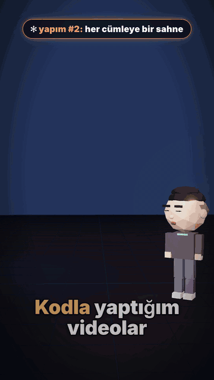
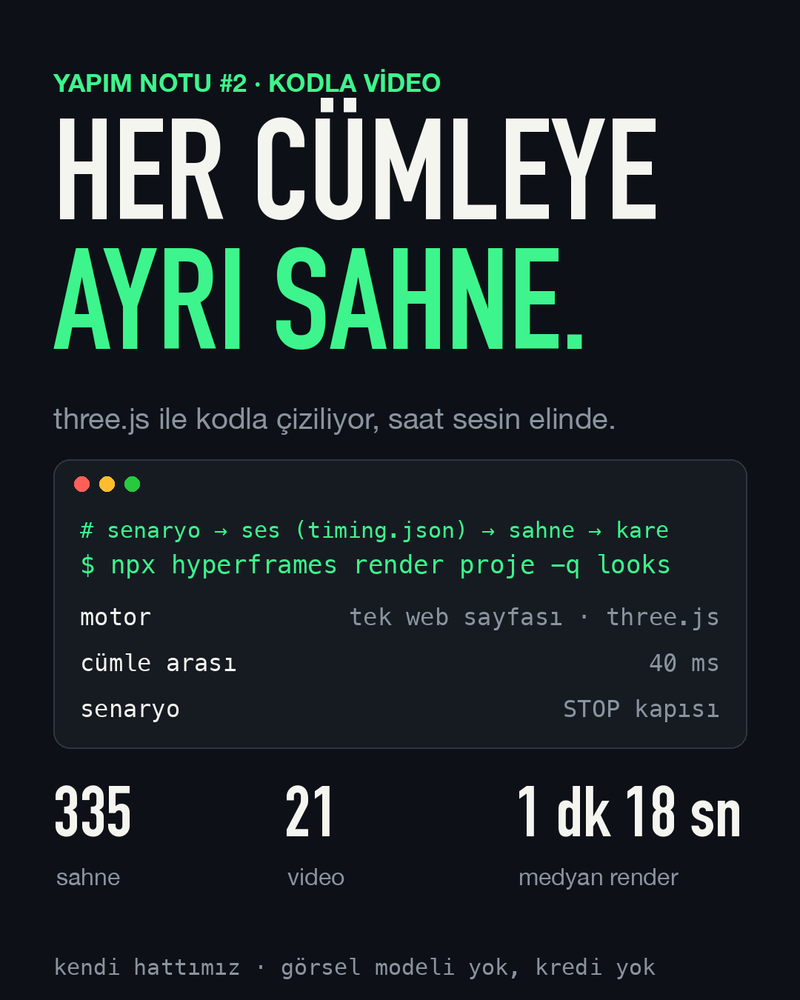

# Kodla yaptığım videolar birbirinin kopyasıydı. Aynı masa, aynı kutu robot, aynı pencere.

Yapım notu #2: her cümleye bir sahne.

Referansla aramızda "dağlar kadar fark" vardı. İlk üç videoda çözümü ikinci cümlede söylüyorduk.

Şimdi böyle yapıyoruz:
→ Motor tek bir web sayfası: three.js ile her sahne kodla çiziliyor (1.735 satır)
→ Her cümleye o kavramı gösteren ayrı sahne: 21 videoda 335 sahne, her videonun kendi seti
→ Saat sesin elinde: her cümlenin başlangıcı ölçülüyor, sahne tam o anda değişiyor (cümle arası 40 ms)
→ HyperFrames sayfayı saniyede 30 kare fotoğraflıyor: 71,7 sn'lik video 2.149 kare
→ Senaryo STOP kapısından geçiyor: kanca dert gösterir, çözüm en erken %30'da, sonuç ekranda

Bu Mac'te 52 render ölçtük: medyan 1 dk 18 sn, ses -14 LUFS'a getiriliyor.

**📊 Rakamlarla:**
• 335 sahne
• 21 video
• 1 dk 18 sn medyan render

**⚙️ Nasıl başlarsın:**
$ npx hyperframes render proje -q looks

**📌 Kısa notlar:**
• motor: tek web sayfası · three.js
• cümle arası: 40 ms
• senaryo: STOP kapısı

**✨ Öne çıkanlar:**
• 21 videoda 335 sahne
• cümle arası 40 ms
• 52 render, medyan 1 dk 18 sn

Notlar için yorumlara KOD yaz, DM'den göndereyim 📩

Siz kodla video yaparken her sahneyi ayrı mı çiziyorsunuz?

[▶ Tam kalite video: video.mp4](video.mp4)

## Videoda adım adım

1. Çözümümüz tek bir web sayfasında yaşayan ve her sahneyi üç boyutlu kodla çizen motorumuz.
2. Her cümleye o kavramı gösteren ayrı bir sahne yazıyoruz, bir videoda 16 sahne.
3. 21 videoda böyle 335 sahne yazıldı, her videonun kendi seti var.
4. Saat sesin elinde, her cümlenin başladığı an ölçülüyor ve sahne tam o anda değişiyor.
5. Cümleler arasında yalnız 40 milisaniye boşluk var, görüntü sesi hiç beklemiyor.
6. Anahtar kelimesi söylendiği anda ekranda anahtar çıkıyor, çünkü olayı kelimenin zamanına bağlıyoruz.
7. Sonra sayfa saniyede 30 kare fotoğraflanıyor, 72 saniyelik video 2.149 kare.
8. Senaryo da bir kapıdan geçiyor, çözüm en erken %30'da gelmeli ve sonuç ekranda görünmeli.
9. Bunu bu bilgisayarda yaptık, kredi harcamadan ve hiçbir görsel modeli çağırmadan.

## Lisans

Bu depodaki video, kart ve metinler MIT lisanslıdır (LICENSE). Anlatılan aracın kendi lisansı kendi deposundadır.
